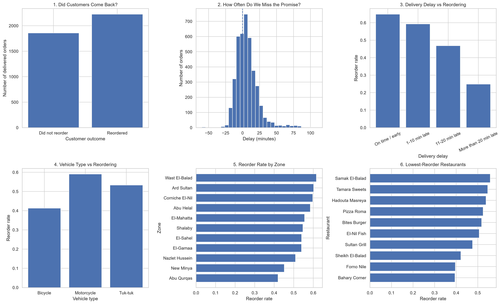

# Sahl Delivery Data Analysis

A comprehensive end-to-end data analysis project focusing on customer retention and delivery performance for a delivery service ("Sahl Delivery" in Minya).

## 📊 Project Overview
This project investigates the core operational drivers affecting customer reorder rates within 30 days. It covers the full data analysis lifecycle:
* **Data Cleaning & Preprocessing:** Handled missing values, dropped near-empty columns, removed duplicates, and standardized messy text (city names, categories) and mixed date formats using `pandas` and `numpy`.
* **Feature Engineering:** Created calculated metrics including delivery delay minutes, on-time delivery flags, delay groupings, and customer retention targets.
* **Exploratory Data Analysis (EDA):** Tested multiple operational factors including vehicle types, zones, restaurants, time of day, and performed dead-end tests on payment methods and discounts.
* **Data Visualization:** Built a comprehensive 6-panel analytical dashboard using `Matplotlib` and `Seaborn`.

## 📈 Dashboard Preview

## 🛠️ Technologies Used
* **Python**
* **Pandas & NumPy** (Data Manipulation & Cleaning)
* **Matplotlib & Seaborn** (Data Visualization)

## 📂 Project Structure
* `Sahl-Minya.py`: The complete Python script containing data cleaning, investigation, and dashboard generation.
* `sahl_dashboard.png`: The generated 6-panel analytical dashboard image.
